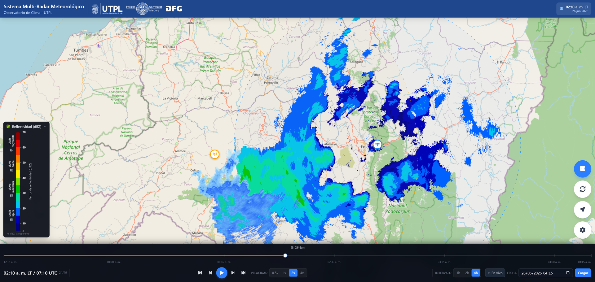

# TAMIA — Edge Computing System for Real-Time Weather Radar Reflectivity (LOXX & GUAXX)

**TAMIA** (*Tropical Andean Meteorological Imaging Architecture*) is the system
described in the paper below. *Tamia* means "rain" in Kichwa.

Source code accompanying the paper:

> **TAMIA: An Edge Computing System for Real-Time Processing and Visualization
> of Weather Radar Reflectivity in the Tropical Andes.**
> S. Quiñones-Cuenca, A. Fries, M. Quiñones-Cuenca and J. Bendix.
> Universidad Técnica Particular de Loja (UTPL), Loja, Ecuador, and Philipps-Universität Marburg, Germany. *(submitted to Remote Sensing, MDPI, 2026).*

This repository contains a functional, self-contained copy of the three-layer
system that processes and visualizes the DBZH reflectivity field of two X-band
weather radars of the RadarNet-Sur network in southern Ecuador in near real time.

> **Note.** Source-code comments and the per-component READMEs are written in
> Spanish; this top-level document is in English to accompany the manuscript.

---

## 1. System architecture

The system is organized in three decoupled layers:

```
        ┌─────────────────────┐        ┌──────────────────────┐        ┌────────────────────┐
        │   EDGE NODES        │  HTTP  │   CENTRAL API        │  WS/   │   WEB VIEWER       │
        │  (one per radar)    │  POST  │  FastAPI + Postgres  │  HTTP  │  React + Leaflet   │
        │  watchdog +         │ ─────► │  stores georef PNGs  │ ─────► │  real-time overlay │
        │  DBZH pipeline      │        │  + WebSocket push    │        │  + time animation  │
        └─────────────────────┘        └──────────────────────┘        └────────────────────┘
```

1. **Edge nodes** (`EDGE/LOXX`, `EDGE/GUAXX`) — one per radar. A `watchdog`
   detects each new radar file, the processing pipeline converts it into a
   georeferenced RGBA PNG, and an uploader POSTs it to the central API.
2. **Central API** (`API_RADAR`) — FastAPI (v2.2) + PostgreSQL. Receives PNGs,
   stores them under `data/radar/{radar_id}/DBZH/{year}/{julian_day}/`, exposes
   REST endpoints and pushes `NEW_RADAR_FRAME` messages over a WebSocket.
3. **Web viewer** (`VISOR`) — React 19 + Leaflet + Zustand. Renders multi-radar
   georeferenced overlays with temporal animation and live push updates.

### Radars

| Radar | Site | Input format | Coordinates | Coverage |
|-------|------|--------------|-------------|----------|
| **LOXX** | Cerro El Tiro, Loja (Furuno WR110) | ODIM HDF5 (`.h5.gz`) | −3.989060, −79.145308 (2 850 m) | ~70 km |
| **GUAXX** | Cerro Guachaurco, Celica (Rainscanner RS120) | NetCDF4 (`.nc4`) | −4.0333, −79.8667 | ~100 km |

Both radars are operated by UTPL within the RadarNet-Sur network.

### Web viewer in action



*Web viewer showing the DBZH reflectivity of both radars overlaid simultaneously
on the OpenStreetMap basemap during the precipitation event of 26 June 2026
(01:10 LT / 06:10 UTC). Same screenshot as Figure 5 of the accompanying paper.*

### DBZH color scale (Furuno WR110 jet, 13 classes)

Reflectivity is rendered with an identical 13-class scale across the edge nodes,
the viewer and the paper figures. Values below **8 dBZ** are transparent.

```
levels (dBZ): 8 10 15 20 25 30 35 40 45 50 55 60 65 70
colors:       #000080 #0000B4 #0060FF #00C8F0 #00E0A0 #00C800 #80E000
              #FFF000 #FFC000 #FF8000 #FF3800 #E00000 #900000
```

---

## 2. Repository structure

```
ZENODO_RADAR/
├── docs/
│   └── img/
│       └── figura_5_visor.png     # web viewer screenshot (README §1, paper Figure 5)
├── EDGE/
│   ├── LOXX/                          # Edge node — Radar Loja (ODIM HDF5)
│   │   ├── generar_png_loxx.py        # DBZH processing pipeline
│   │   ├── loxx_dbzh_georeferenciado.py
│   │   ├── radar_edge_uploader_loxx.py# watchdog + uploader (reads key from env/ini)
│   │   ├── clutter_cache_dbzh.pkl  # precomputed clutter map
│   │   ├── config.ini
│   │   ├── uploader_config.ini.example
│   │   ├── requirements.txt
│   │   ├── README.md
│   │   └── data_test/                 # example input frames (see §5)
│   └── GUAXX/                         # Edge node — Radar Celica (NetCDF4)
│       ├── generar_png_radar.py       # DBZH processing pipeline
│       ├── radar_edge_uploader_guaxx.py
│       ├── config.ini                 # no plaintext secrets
│       ├── .env.example
│       ├── README.md
│       ├── requirements.txt
│       └── data_test/                 # example .nc4 frames
├── API_RADAR/                         # Central API (FastAPI + PostgreSQL)
│   ├── main.py                        # endpoints + WebSocket
│   ├── database.py  models.py
│   ├── .env.example
│   └── requirements.txt
├── BD/                               # Database
│   ├── schema.sql
│   └── migrate_history.py
├── VISOR/                            # Web viewer (React + Vite + Leaflet)
│   ├── src/  public/  index.html
│   ├── package.json  package-lock.json
│   ├── vite.config.js  eslint.config.js
│   └── .env.example
├── data/
│   └── evaluation/                   # measurement records of the paper's evaluation (see §6)
│       ├── README.md                 # data dictionary
│       ├── reproduce_key_figures.py  # recomputes every figure of the Results section
│       ├── DATA_LICENSE.txt          # CC BY 4.0
│       └── *.csv                     # 11 record files
├── CITATION.cff
├── LICENSE                           # MIT (source code)
└── README.md                         # this file
```

`node_modules/` and `dist/` are not shipped — regenerate them with
`npm install` / `npm run build`. No real `.env` files are included, only
`*.example` templates.

---

## 3. Requirements

- **Edge nodes:** Python 3.11. See `EDGE/<RADAR>/requirements.txt`.
  `GDAL`/`cartopy` (LOXX) are easiest to install with conda:
  `conda install gdal cartopy`.
- **Central API:** Python 3.11, PostgreSQL 14+. See `API_RADAR/requirements.txt`.
- **Web viewer:** Node.js 20+ and npm.

---

## 4. Quick start

### 4.1 Central API

```bash
cd API_RADAR
python -m venv .venv && source .venv/bin/activate   # Windows: .venv\Scripts\activate
pip install -r requirements.txt
cp .env.example .env          # set DATABASE_URL and RADAR_API_KEY
# create the schema in PostgreSQL:
psql "$DATABASE_URL" -f ../BD/schema.sql
uvicorn main:app --host 0.0.0.0 --port 8000
```

Main endpoints:

| Method | Path | Description |
|--------|------|-------------|
| `POST` | `/upload/{radar_id}` | Ingest a georeferenced PNG frame (`X-Api-Key` header) |
| `GET`  | `/frames/{radar_id}` | List stored frames for a radar |
| `GET`  | `/radars` | List registered radars |
| `WS`   | `/ws/radar/updates` | Push channel (`NEW_RADAR_FRAME`) |

### 4.2 Edge node (example: LOXX)

```bash
cd EDGE/LOXX
pip install -r requirements.txt
# Configure the uploader (choose ONE):
#   a) environment variables: RADAR_API_KEY, RADAR_API_URL, RADAR_WATCH_DIR, RADAR_OUTPUT_DIR
#   b) copy uploader_config.ini.example -> uploader_config.ini and fill it (git-ignored)
python radar_edge_uploader_loxx.py
```

Process a single stored frame without the watchdog (uses `data_test/`):

```bash
python generar_png_loxx.py   # see the script header for CLI options
```

GUAXX is analogous (`EDGE/GUAXX`, uses `.env` / `.env.example`; see its
`README.md`).

### 4.3 Web viewer

```bash
cd VISOR
npm install
cp .env.example .env          # set VITE_API_BASE (default http://localhost:8000)
npm run dev                   # development
npm run build                 # production build -> dist/
```

---

## 5. Example data (`data_test/`)

Small example datasets are included so the pipeline can be run end-to-end
without access to the live radars:

- **LOXX** `data_test/20260626/` — 7 ODIM HDF5 frames of the 26 June 2026
  convective event: six frames at 10-min steps (03:15–04:05 UTC) used in the
  temporal-sequence figure, plus the 06:10 UTC frame used in the
  clutter-correction figure.
- **LOXX** `data_test/clutter_data/` — 5 frames used to illustrate clutter-map
  computation (`clutter_cache_dbzh.pkl` is already provided).
- **GUAXX** `data_test/` — 6 NetCDF4 frames (2 April 2025).

These example datasets are licensed under **CC BY 4.0** (see the
`DATA_LICENSE.txt` file in each `data_test/` directory), separately from the
source code.

---

## 6. Evaluation data (`data/evaluation/`)

The measurement records that support the operational evaluation reported in the
paper (91 days of production, 14 April–13 July 2026) are included as 11 CSV
files with an English data dictionary (`data/evaluation/README.md`): the export
of the frame registry, the arrival times of the raw files at the LOXX node, the
logs of the controlled reprocessing on both nodes, the leave-one-out validation
of the clutter correction, the multi-elevation compositing comparison, the
WebSocket push-latency test and the link-throughput measurements. Every number
of the Results section can be recomputed with

```bash
cd data/evaluation
python reproduce_key_figures.py      # Python 3.8+, standard library only
```

The script prints each figure next to the value stated in the article. These
records are licensed under **CC BY 4.0** (see `data/evaluation/DATA_LICENSE.txt`).

---

## 7. Configuration and security

- Secrets are **never** hardcoded. Uploaders and the API read the API key from
  environment variables (or a git-ignored `uploader_config.ini` / `.env`).
- Only `*.example` templates are distributed; fill your own values locally.
- The API protects `/upload` with the `X-Api-Key` header.

---

## 8. Citation

If you use this software, please cite the accompanying paper (see top of this
file) and this software deposit:

```
Quiñones-Cuenca, S.; Fries, A.; Quiñones-Cuenca, M.; Bendix, J. TAMIA: Edge
Computing System for Real-Time Weather Radar Reflectivity (v1.1.0). Zenodo, 2026.
https://doi.org/10.5281/zenodo.22308494
```

Machine-readable metadata are in [`CITATION.cff`](CITATION.cff).

---

## 9. License

- **Source code** — released under the **MIT License**; see the
  [`LICENSE`](LICENSE) file. © 2026 Santiago Quiñones-Cuenca, Andreas Fries, Manuel Quiñones-Cuenca (Universidad Técnica Particular de Loja).
- **Example radar data** (`EDGE/*/data_test/`) and **evaluation records**
  (`data/evaluation/`) — released under **CC BY 4.0**; see the
  `DATA_LICENSE.txt` file in each of those directories.

---

## 10. Funding and acknowledgments

This research was funded by Universidad Técnica Particular de Loja (UTPL),
through the projects PROY_VIN_CLIMA_2024_4209
and PROY_INV_IC_2024_4464.

The radar equipment was provided by the Philipps-Universität Marburg (Germany)
within the RadarNet-Sur network, funded by the Deutsche Forschungsgemeinschaft
(DFG); the radars are operated by the Climate Observatory and the Hydrology and
Climatology Research Group (GTHC, *Grupo de Investigación de Hidrología y
Climatología*) of UTPL.
